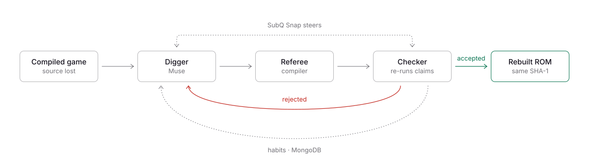
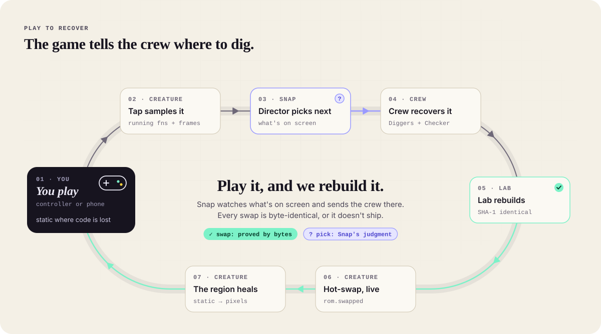
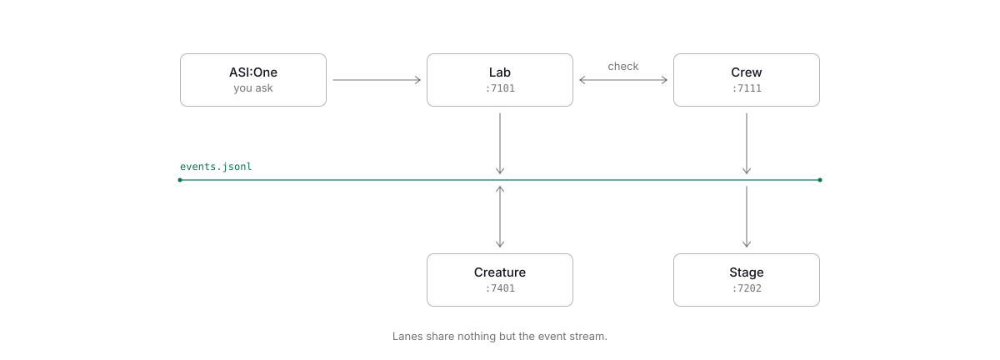

# Frankenstein

**Lost games, rebuilt and proven.**

[](https://tryfrankenstein.pages.dev)
[](LICENSE)
[](#built-today--not-ours)
[](https://github.com/doomhack/GBADoom)

`#game-preservation` `#matching-decompilation` `#coding-agents` `#multi-agent` `#verification` `#gba` `#muse-spark` `#subquadratic` `#fetch-ai` `#mongodb` `#hackathon`

87% of classic games are endangered, and most of their source code is gone.
Frankenstein's agents rebuild it from the cartridge, one piece at a time.
A compiler checks every byte.

**Live site:** [tryfrankenstein.pages.dev](https://tryfrankenstein.pages.dev)

> Victor Frankenstein never checked his work. Ours checks everything.

<picture>
  <source media="(prefers-color-scheme: dark)" srcset="docs/diagrams/how-it-works-dark.svg">
  
</picture>

## The story in five beats

1. **The patient.** A classic game whose source code is gone. It runs; nobody can fix it.
2. **You ask.** "Bring back Doomguy's face," in an ASI:One chat. SubQ Snap ranked the real face function first (p 0.88).
3. **The crew digs.** Diggers write C and the Checker re-runs every claim. "Matched it. Pretty sure." gets stamped REJECTED.
4. **It's alive.** Recovered functions go back into the ROM. Same SHA-1, or it doesn't ship.
5. **It changes again.** Edit the C, patch one function, and the room plays the fixed game on their phones.

<picture>
  <source media="(prefers-color-scheme: dark)" srcset="docs/diagrams/play-to-recover-dark.svg">
  
</picture>

## Emulators keep games playable. Source code keeps them alive.

87% of classic games released in the US are critically endangered (Video Game History Foundation and Software Preservation Network, 2023). For most of them, only the compiled cartridge survives. It runs, but nobody can fix it.

## How it works

1. **Dig.** Agents read the compiled game and write C, one function at a time.
2. **Check.** A compiler rebuilds every piece. Byte-identical or it's out. Lies get caught.
3. **Learn.** Every match teaches the crew a habit, so the next game goes faster. Habits that stop helping get retired.

> Play it, and we rebuild it. SubQ Snap watches the live game and sends the crew to whatever is on screen.

## The proof

Doom is our first patient: famous, hidden from the agents, scrambled so they can't recite it, and checkable byte for byte.

| What | Result | Source |
|---|---|---|
| First Doom run (`doom_r01`, the 30 smallest functions) | 28 of 30 matched, 1.29 attempts per match, 268 s, $0.73 of Muse + $0.06 of Snap, 0 false claims, 38 habits learned | `DECISIONS.md` |
| Snap router, "Doomguy's face" | The real face function ranked #1 (p 0.88), checked afterwards against the hidden map | `DECISIONS.md` |
| Bench (not Doom: 20 small functions written today, `-O2`) | 14 of 14 matched, 12 first try, 80 s, $0.29, 0 false claims, 24 idioms learned | `runs/bench_r01`, `DECISIONS.md` |
| Doom target | 795 functions, 170 held out | `lab/out/manifest.json` |
| Referee | 0.1 to 0.2 s per check | `DECISIONS.md` |
| Full-game Doom results | measured live today | `runs/*/metrics.json` |

**Evidence rule.** Bright means proved by the compiler. Violet with a "?" means our guess.

## Agents lie. The referee doesn't.

Every "I matched it" is re-run by the Checker with a fresh compile. A match that doesn't hold is rejected with the first instruction that differs, and counted. The referee has never told a joke.

## Sponsors are the organs, not the logos

| Partner | Role | One line |
|---|---|---|
| Meta Model API (Muse Spark, Muse Wonder) | The hands | Writes every line of recovered C. |
| Subquadratic (SubQ Snap) | The judgment | Reads the whole game at once and decides where every attempt goes. |
| Fetch.ai (ASI:One) | The front door | Ask for a recovery in a chat. Get proof back. |
| MongoDB Atlas | The memory | Remembers every trick, so the next game is faster. |
| Google Gemini | The second opinion | A different lab double-checks every match. It also rendered every illustration on the site, today (`site/tools/generate_art.py`). |

## Built today / Not ours

| Built today (Nov 7, 2026, after 10:45 PT) | Not ours |
|---|---|
| Everything in `contracts/`, `lab/`, `crew/`, `stage/`, `creature/`, `site/` | **Doom** by id Software; **prBoom** by its authors; **GBADoom** by doomhack (GPL-2.0-or-later), used only as the hidden answer key and never committed |
| The build and split, referee and linter, agents, Stage scenes, emulator overlay, phone page and site | Muse Spark and Muse Wonder (Meta), SubQ Snap (Subquadratic), ASI:One and Agentverse (Fetch.ai), MongoDB Atlas, Gemini (Google), mGBA, devkitARM, Google Fonts |
| | **Prior work:** the planning kit in `docs/` (including `docs/design_system.html`, a visual reference only) and the event clock `tools/hackclock.py` |

## The team

| Lane | Owner | What it does |
|---|---|---|
| **A · The Lab** | Eddy | Builds the game, runs the referee, hosts the ASI:One agent. [`lab/`](lab/README.md) |
| **B · The Crew** | Karthik | The Diggers, the Checker, Snap steering and the idiom library. [`crew/`](crew/README.md) |
| **C · The Stage** | | The live show, driven only by the event stream. [`stage/`](stage/README.md) |
| **D · The Creature** | Enzo | Doom in an emulator, healing as its code comes back, plus the phone page. [`creature/`](creature/README.md) |

[`DECISIONS.md`](DECISIONS.md) is the engineering log.

## Architecture

<picture>
  <source media="(prefers-color-scheme: dark)" srcset="docs/diagrams/system-dark.svg">
  
</picture>

<details>
<summary>Plain-text version, for terminals</summary>

```text
  lab/secrets/   answer key · gitignored · only the referee reads it
                │
                ▼
┌─ A · LAB  (referee) ─────────┐                          ┌─ B · CREW  (agents) ─────────┐
│ check · rebuild · patch      │ ─ manifest · asm · ctx ▶ │ Diggers · Muse Spark         │
│ serve :7101                  │                          │ Checker · SubQ Snap gate     │
│ ASI:One agents · Fetch.ai    │ ◀──── POST /check ────── │ Snap triage · escalate       │
│                              │  POST /jobs  (ASI:One) ▶ │ jobs API :7111               │
└───────────────┬──────────────┘                          └───────────────┬──────────────┘
                │                                                         │ appends
                │                                                         │
                │                                                         ▼
                │ build.rom             ┌─────────────────────────────────┴────────────────┐
                │ patched.gba           │  runs/live/events.jsonl · metrics.json           │
                │                       └───────┬─────────────────────────┬────────────────┘
                │                               │                         │
                │                               │                         │ tail · ws :7202
                │                               │                         │
                │                               │                         │
                ▼                               │                         ▼
┌─ D · CREATURE  (game) ───────┐                │         ┌─ C · STAGE  (show) ──────────┐
│ mGBA · heal overlay          │◀─ fn.matched ──┘         │ Title · Split · Versus       │
│ hot-swap · bug fix           │                          │ Time trial · Ending          │
│ heartbeat ▶ crew :7112       │                          │ replay 1-20x                 │
│                              │                          │                              │
└───────────────┬──────────────┘                          └───────────────┬──────────────┘
                │                                                         │
                ▼                                                         ▼
         phones · video                                                judges · projector
```

</details>

Lanes share only what is in [`contracts/CONTRACTS.md`](contracts/CONTRACTS.md): file shapes (JSON Schema in `contracts/schemas/`), the referee and crew HTTP APIs, and the append-only `runs/<run_id>/events.jsonl`. Every lane builds against `contracts/fixtures/` from minute one.

## Why it's fast enough

The slow parts are model calls (seconds) and the compiler (0.1 to 0.2 s). So we parallelize Diggers, cache prompts and verdicts, and start easy functions at lower effort. We didn't port anything to Rust or Go: the bottleneck is the model, not our code.

## How to run

```bash
make setup         # .venv with jsonschema, python-dotenv, pytest
make fixtures      # regenerate contracts/fixtures (deterministic, all marked fixture)
make validate      # validate fixtures, runs/*, lab/out/*.json against the schemas
make test          # contract tests
make sample-runs   # runs/fx01..fx03 + runs/live -> fx01, for Stage/Creature dev
make clock         # print the event schedule
```

- Referee: `lab/setup_referee.sh`, then `python3 -m lab.referee serve`. See [`lab/README.md`](lab/README.md).
- Crew: `python -m crew.run`, and `python -m crew.serve` for the jobs API. See [`crew/README.md`](crew/README.md).
- Site: `python3 -m http.server -d site 8000`. Pushes to `main` that touch `site/**` deploy to Cloudflare Pages.

## Repo map

```
docs/        planning kit (prior work)            contracts/  shared schemas, fixtures, validator
lab/         Lane A: build, referee, agent        crew/       Lane B: agents and experiments
stage/       Lane C: the live show                creature/   Lane D: emulator, overlay, phone
site/        public landing page                  runs/       run output (gitignored)
tools/       event clock (prior work)
```

## Contributing

Commit inside your lane folder, `git pull --rebase` before every push, never force-push `main`. Contract changes need a line in `DECISIONS.md`.

## New Game+

Anywhere the only thing left is the compiled program, Frankenstein can bring the source back. Games don't have to die.

## License

MIT. See [LICENSE](LICENSE). This repo contains none of GBADoom's code or data. Doom is a trademark of id Software; we are not affiliated with id Software or doomhack.
